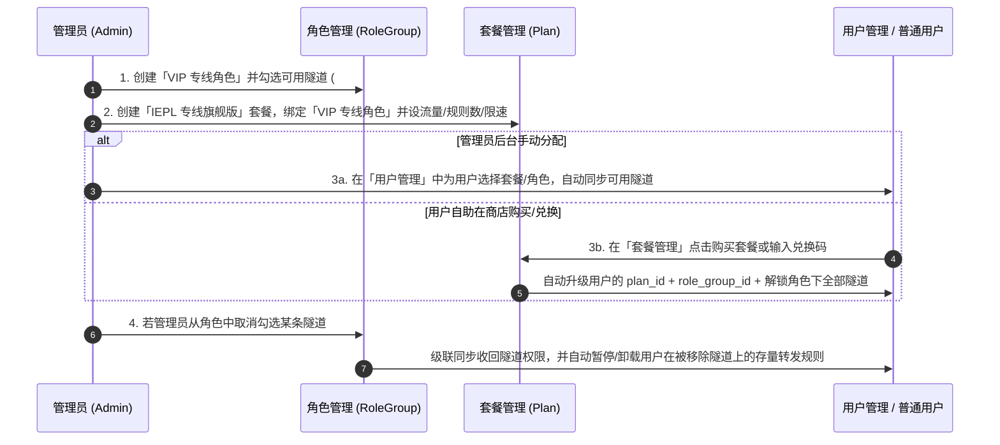

# Nexus Panel 分布式多引擎流量转发面板 —— 部署与使用完整手册

本文档涵盖 **Nexus Panel** 从 **主控端（Master）部署** $\rightarrow$ **节点端（Agent）对接** $\rightarrow$ **创建端口/加密隧道** $\rightarrow$ **角色 / 套餐 / 用户权限配置（类 Xboard 模式）** $\rightarrow$ **日常转发规则管理与运维排障** 的全流程操作指南。

---

## 一、 架构总览与核心设计


### 1.1 四大转发方式（创建隧道时固化）

| 转发方式 | 核心特点 | 适用场景 |
| :--- | :--- | :--- |
| **`realm`** | Rust 编写，极低内存占用、高并发 TCP/UDP 零配置直转 | 入口单机中转、BGP / IEPL 专线直连转发（**推荐直转首选**） |
| **`gost`** | 支持 `TLS` / `WSS` / `WS` / `QUIC` 多协议双端加密隧道 | 跨公网入口 $\rightarrow$ 出口双节点加密隧道转发（**推荐加密隧道首选**） |
| **`nftables`** | Linux 内核态 `DNAT/SNAT` 零拷贝转发，几乎 0 CPU 占用 | 超大带宽（10Gbps+）Linux 专线入口节点纯内核态端口转发 |
| **`native`** | 纯 Go 内置转发底座，支持令牌桶精准限速与双端 `40-Byte HMAC` 首包防探测鉴权 | 无外部二进制依赖的通用转发、精准单规则限速、主备故障自动切换 |

---

## 二、 主控面板（Master）部署指南

### 2.1 环境要求
- **操作系统**：Linux（Ubuntu 20.04+ / Debian 11+ / CentOS 8+）或 Windows Server
- **硬件建议**：1 核 CPU / 1 GB 内存 / 10 GB 磁盘即可流畅支撑百台节点
- **开放端口**：默认 `8080/tcp`（同时承载 Web 面板与 Agent WebSocket 通信 `/api/v1/agent/ws`）

---

### 2.2 方式一：Docker Compose 一键部署（生产推荐）

在服务器任意目录（如 `/opt/nexus-panel`）拉取代码并启动：

```bash
cd /opt/nexus-panel/deploy
docker compose up -d --build
```

默认 [`deploy/docker-compose.yml`](./deploy/docker-compose.yml) 配置如下：

```yaml
version: "3.9"

services:
  nexus-master:
    build:
      context: ..
      dockerfile: deploy/Dockerfile.master
    container_name: nexus-master
    restart: always
    ports:
      - "8080:8080"
    environment:
      - NEXUS_LISTEN=:8080
      - NEXUS_DB_DRIVER=sqlite
      - NEXUS_DB_DSN=/data/nexus_panel.db
      - NEXUS_JWT_SECRET=please-change-to-your-production-secret-key
    volumes:
      - ./data:/data
```

> [!TIP]
> **切换 PostgreSQL 或 MySQL 数据库**：
> - **PostgreSQL**：设置 `NEXUS_DB_DRIVER=postgres`，`NEXUS_DB_DSN="host=127.0.0.1 user=nexus password=xxx dbname=nexus port=5432 sslmode=disable"`
> - **MySQL**：设置 `NEXUS_DB_DRIVER=mysql`，`NEXUS_DB_DSN="nexus:password@tcp(127.0.0.1:3306)/nexus?charset=utf8mb4&parseTime=True&loc=Local"`

---

### 2.3 方式二：源码编译与 Systemd 裸机部署

```bash
# 1. 编译前端静态资源 (可选，若使用独立托管)
cd /opt/nexus-panel/web
npm install && npm run build

# 2. 编译主控端与节点端二进制
cd /opt/nexus-panel
CGO_ENABLED=1 go build -o bin/nexus-master ./cmd/master
CGO_ENABLED=0 go build -o bin/nexus-agent ./cmd/agent

# 3. 启动主控端
export NEXUS_JWT_SECRET="your-strong-random-jwt-secret"
./bin/nexus-master -listen :8080 -db-driver sqlite -db-dsn ./nexus_panel.db
```

---

### 2.4 配置 Nginx 反向代理（启用 HTTPS 与 WSS）

如果希望通过域名（例如 `panel.example.com`）访问主控并让节点使用 `wss://` 加密连接，请确保配置了 **WebSocket Upgrade 请求头**：

```nginx
server {
    listen 443 ssl http2;
    server_name panel.example.com;

    ssl_certificate     /etc/ssl/certs/panel.crt;
    ssl_certificate_key /etc/ssl/private/panel.key;

    location / {
        proxy_pass http://127.0.0.1:8080;
        proxy_http_version 1.1;
        proxy_set_header Host $host;
        proxy_set_header X-Real-IP $remote_addr;
        proxy_set_header X-Forwarded-For $proxy_add_x_forwarded_for;
        proxy_set_header X-Forwarded-Proto $scheme;

        # 必须开启 WebSocket 支持，供 /api/v1/agent/ws 节点通信使用
        proxy_set_header Upgrade $http_upgrade;
        proxy_set_header Connection "upgrade";
        proxy_read_timeout 3600s;
    }
}
```

---

### 2.5 默认初始化账号与登录

面板首次启动会自动迁移数据库并预置两套演示账号（生产环境登录后请立即在「用户管理」中修改密码）：

| 账号角色 | 登录邮箱 | 默认密码 | 默认所属角色 / 权限说明 |
| :--- | :--- | :--- | :--- |
| **管理员 (`admin`)** | `admin@nexus.local` | `admin123` | **全权限管理员**：可维护节点、隧道、角色、套餐、用户与系统设置，拥有全部隧道 (`*`) 权限 |
| **普通用户 (`user`)** | `user@nexus.local` | `user123` | **普通用户**：初始绑定 `轻量标准版 (BGP)` 与 `标准角色`，仅可使用已授权的隧道创建转发规则 |

---

## 三、 节点端（Agent）对接与运维指南

### 3.1 第一步：在面板中添加节点

使用 **管理员账号** 登录面板，点击左侧菜单 **「基础设施」 $\rightarrow$ 「节点管理」 $\rightarrow$ 「+ 新增节点」**：

| 配置项 | 填写说明 | 示例 |
| :--- | :--- | :--- |
| **名称** | 节点标识名称，便于区分地域或线路类型 | `深圳前海 BGP 入口 #1` |
| **连接地址 (`connect_ip`)** | **面向最终客户端连接使用的公网 IP 或 CNAME 域名**。用户在「转发管理」列表点击复制的连接地址即取自此字段 | `120.24.100.10` 或 `sz-bgp.example.com` |
| **节点 IP (`server_ip`)** | **节点服务器真实公网/专线内网通信 IP**。当该节点作为加密隧道的「出口节点」时，入口节点将向此 IP 发起隧道对接；留空默认同连接地址 | `10.10.10.2` 或 `203.0.113.20` |
| **端口范围 (`port_range`)** | 允许用户在该节点上分配监听端口的范围（面板会自动规避冲突端口与系统高危端口） | `10000-50000` |
| **流量倍率 (`traffic_rate`)** | 节点级基准倍率（默认为 `1.0`） | `1.0` |
| **流量限额 (GB)** | 该节点服务器月度总流量上限（填 `0` 表示不限制）。**当节点已用流量达到限额时，面板会自动熔断暂停该节点上的转发规则** | `2000` |
| **已用流量 (GB)** | 可手动校准当前节点的已消耗流量 | `0` |

---

### 3.2 第二步：获取对接命令并部署 Agent

节点创建后，在「节点管理」列表中点击该节点右侧的 **「对接」** 按钮，面板会自动生成带专属 `Node ID` 与 `HMAC Secret Token` 的一键安装与卸载命令。支持 **Systemd 服务（推荐）** 和 **Docker 容器** 两种部署方式：

#### 方式 A：Systemd 系统服务部署（推荐，支持 `nftables` 内核转发与进程级端口统计）

- **一键安装命令**（在目标节点服务器上以 `root` 执行）：
  ```bash
  curl -fsSL http://<主控IP或域名>:8080/deploy/install-agent.sh | sudo bash -s -- \
    --master "ws://<主控IP或域名>:8080/api/v1/agent/ws" \
    --id 1 \
    --token "<面板生成的节点专属Token>"
  ```
- **一键卸载命令**（自动停止服务、清理 `/etc/nexus-agent` 快照与 `nftables` 内核规则表）：
  ```bash
  curl -fsSL http://<主控IP或域名>:8080/deploy/install-agent.sh | sudo bash -s -- --uninstall
  ```
- **常用服务管理命令**：
  ```bash
  # 查看 Agent 运行状态与实时日志
  systemctl status nexus-agent
  journalctl -u nexus-agent -f

  # 手动重启 Agent 服务（重启后毫秒级自动恢复全部转发规则）
  systemctl restart nexus-agent
  ```

#### 方式 B：Docker Host 网络容器部署

- **一键安装命令**（必须使用 `--net=host` 与 `--cap-add=NET_ADMIN`）：
  ```bash
  docker run -d --name nexus-agent-1 --restart always \
    --net=host --cap-add=NET_ADMIN \
    -e NEXUS_MASTER_URL="ws://<主控IP或域名>:8080/api/v1/agent/ws" \
    -e NEXUS_NODE_ID=1 \
    -e NEXUS_NODE_TOKEN="<面板生成的节点专属Token>" \
    ghcr.io/nexus-panel/agent:latest
  ```
- **一键卸载命令**：
  ```bash
  docker stop nexus-agent-1 && docker rm -v nexus-agent-1
  ```

---

### 3.3 节点同步频率与服务重启自愈机制

1. **三层同步策略**：
   - **探针与流量同步（`3 秒/次`）**：Agent 每 3 秒采集一次节点 CPU、负载 (`Load 1/5/15`)、内存容量、硬盘容量、实时上下行网卡速率、活跃连接数及每条规则的精确进出流量增量上报主控；管理员「概览」页每 3 秒静默刷新展示。
   - **规则变更推送（`0 延迟实时下发`）**：新增、编辑、暂停、删除规则或调整角色权限时，主控通过 WebSocket 实时推送经 `HMAC-SHA256` 签名的指令帧到对应节点。
   - **全量状态对账（`60 秒/次`）**：主控后台每 60 秒执行一次配额巡检与在线节点全量规则哈希对账（`ReconcileAllOnlineNodes`）。
2. **服务重启规则自愈（双重保障）**：
   - **本地持久化快照秒级恢复**：Agent 每次接收规则变更都会原子写入本地快照（`/etc/nexus-agent/rules-snapshot.json` 或 `/tmp/nexus-agent-state/rules-snapshot.json`）。当服务器重启或 `nexus-agent` 进程重启时，Agent 启动第一件事即调用 `RestoreSnapshot` 立即拉起所有转发规则，**即使此时主控端短暂离线也不影响转发业务恢复**。
   - **主控重连全量重同步 + 手动一键同步**：Agent 重连上主控 WebSocket 的瞬间，主控会自动下发最新全量启用规则；管理员也可随时在「节点管理」点击 **「同步」** 按钮强制重启并同步该节点的所有规则。

---

## 四、 创建隧道指南（端口转发 vs 隧道转发）

> [!IMPORTANT]
> **核心原则**：在 Nexus Panel 中，**转发方式（`realm` / `gost` / `nftables` / `native`）与出入节点拓扑在「创建隧道」时即已固化**。用户在创建转发规则时只需选择已授权的隧道，无需也无权篡改底层转发方式。

点击左侧菜单 **「基础设施」 $\rightarrow$ 「隧道管理」 $\rightarrow$ 「+ 新增隧道」**：

### 4.1 模式一：端口转发 (`direct` · 单节点直转)
适用于单台入口服务器直接将流量转发至目标地址（或通过内网专线直连目标）：
1. 选择顶部模式卡片：**「端口转发」**。
2. **名称**：例如 `深港专线直转`。
3. **转发方式**：推荐选择 `realm`（极速轻量）或 `nftables`（Linux 内核态零拷贝）。
4. **入口节点**：选择已在线的入口节点（如 `深圳入口 #1`）。
5. **计费方式 / 流量倍率 / 端口配额**：
   - **单向计费 (`one_way`)**：取 $\max(\text{上行流量}, \text{下行流量}) \times \text{流量倍率}$ 计入用户已用流量。
   - **双向计费 (`two_way`)**：取 $(\text{上行流量} + \text{下行流量}) \times \text{流量倍率}$ 计入用户已用流量。
   - **端口配额 (`max_port_count`)**：限制该隧道下最多允许创建的转发规则数量（如 `100`）。

### 4.2 模式二：隧道转发 (`encrypt` · 入口-出口双端加密专线)
适用于「国内公网入口节点 $\rightarrow$ 海外/香港出口节点」需要加密隐藏流量特征的场景：
1. 选择顶部模式卡片：**「隧道转发」**。
2. **名称**：例如 `广港加密隧道`。
3. **转发方式**：推荐选择 `gost` 或 `native`。
4. **入口节点**：选择国内入口节点（如 `广州入口 #1`）。
5. **出口节点**：选择境外/落地出口节点（如 `香港出口 #2`）。
6. **传输协议**：支持选择 `TLS`、`WSS`、`WS`、`QUIC`。
   - **自动化双端编排说明**：当用户在该加密隧道下创建一条转发规则时，主控 `Orchestrator` 会自动完成两步下发：
     1. 在 **出口节点** 自动分配中继监听端口并生成 `32字节随机隧道密钥`（启用 `40-Byte HMAC` 首包防探测校验，任何未授权扫描器连接出口端口将被静默丢弃）；
     2. 在 **入口节点** 自动配置加密客户端对接出口节点的 `server_ip:中继端口`，实现零手工干预的双端加密链路闭合。

---

## 五、 角色 / 套餐 / 用户权限配置全流程（类 Xboard 模式）

Nexus Panel 采用与 **Xboard / V2Board** 一致的 **「角色决定可用隧道 $\rightarrow$ 套餐绑定角色 $\rightarrow$ 用户分配套餐与角色」** 三级权限架构，彻底杜绝普通用户越权使用未授权的高级专线。



### 5.1 第一步：配置「角色管理」（决定可用哪些隧道）
1. 进入左侧菜单 **「权限与系统」 $\rightarrow$ 「角色管理」**。
2. 点击 **「+ 新增角色」** 或点击现有角色的 **「编辑 / 配置隧道」**：
   - **角色名称**：例如 `标准角色`、`VIP 专线角色`、`企业定制角色`。
   - **角色说明**：备注该角色适用的线路等级。
   - **可用隧道**：勾选允许该角色使用的隧道（例如 `标准角色` 仅勾选 `#1 深港专线直转`；`VIP 专线角色` 勾选 `#1 深港专线直转` + `#2 广港加密隧道`）。
3. **级联生效规则**：保存角色后，所有绑定该角色的 **套餐 (`Plan`)** 与 **普通用户 (`User`)** 的可用隧道会**立即同步更新**。如果某条隧道权限被移除，该角色下所有用户在被移除隧道上的存量规则会**立即自动暂停并从 Agent 节点卸载**，且禁止用户再次开启。

---

### 5.2 第二步：配置「套餐管理」（套餐绑定角色）
1. 进入左侧菜单 **「业务中心」 $\rightarrow$ 「套餐管理」**（管理员视角顶部会显示套餐管理总表与 **「+ 新增套餐」** 按钮）。
2. 点击 **「+ 新增套餐」** 或 **「编辑」**：
   - **套餐名称**：如 `IEPL 专线旗舰版`。
   - **绑定角色 (`role_group_id`)**：下拉选择刚才创建的 `VIP 专线角色`（弹窗内会实时预览该角色包含的可用隧道标签）。
   - **价格 (元) & 周期 (天)**：如 `89.00` 元 / `30` 天。
   - **流量配额 (GB) / 最大规则数 / 限速 (Mbps)**：如 `1024 GB`、`50 条规则`、`500 Mbps`。
3. **用户购买与兑换自动升级**：
   - 当普通用户在「套餐管理」中点击 **「立即订阅并激活角色」** 或使用绑定了该套餐的兑换码核销后，系统会通过数据库事务原子扣费，并自动将用户的 `plan_id`、`role_group_id`、`allowed_tunnels`、流量配额、最大规则数和限速同步升级为该套餐的配置。

---

### 5.3 第三步：配置「用户管理」（为用户分配套餐与角色）
1. 进入左侧菜单 **「权限与系统」 $\rightarrow$ 「用户管理」**。
2. 点击 **「+ 新增用户」** 或某位用户右侧的 **「分配套餐/角色」**：
   - **分配套餐 (`plan_id`)**：下拉选择套餐（如切换为 `IEPL 专线旗舰版`）时，表单会**自动联动带出**该套餐绑定的 **所属角色 (`VIP 专线角色`)** 以及对应的流量配额、规则数量和限速。
   - **分配角色 (`role_group_id`)**：管理员也可以在不改变用户套餐配额的前提下，单独调整用户的「分配角色」以临时调整其可用隧道范围。
   - **流量与状态维护**：支持手动调整用户的总流量配额 (`quota_gb`) 与已用流量 (`used_gb`)、点击 **「重置流量」** 一键清零已用流量并自动恢复因超额暂停的规则、点击 **「封禁 / 解封」** 实时切断或恢复该用户的全部转发服务。

---

### 5.4 第四步：配置「系统设置」（全局品牌与新用户默认角色）
进入左侧菜单 **「权限与系统」 $\rightarrow$ 「系统设置」**：
- **面板名称 & Logo 标识**：自定义左上角与登录页展示的品牌名称（如 `Nexus Panel`）及 2~4 字符渐变徽标（如 `NX`）。
- **系统公告**：填写后会醒目展示在所有用户的「概览」页顶部；留空则自动隐藏。
- **开放注册 & 新注册用户默认角色**：控制是否允许外部用户自助注册，并指定新注册用户默认分配的角色（如 `标准角色`）及初始赠送流量/规则数/限速。

---

## 六、 用户端转发规则使用指南

普通用户登录后，左侧菜单仅展示 **「概览」**、**「转发管理」**、**「套餐管理」** 三个模块（无权查看节点服务器硬件探针、节点内部 `server_ip` 及任何管理员菜单）。

### 6.1 新增与编辑单条转发规则
1. 进入 **「转发管理」**，点击右上角 **「+ 新增转发」**（或在「概览」页已授权隧道列表右侧点击 **「添加转发」**）：
   - **隧道**：下拉框仅展示当前用户所属角色已授权的隧道（后端接口同样执行强制 `HasTunnelPermission` 校验，严防抓包篡改 `tunnel_line_id` 越权）。
   - **名称**：填写业务备注名称（如 `港服游戏加速`）。
   - **协议**：支持 `TCP`、`UDP`、`TCP+UDP (both)`。
   - **监听端口**：可指定节点端口范围（如 `10000-50000`）内的端口号，或填 `0` / 留空由系统自动分配空闲端口。
   - **负载均衡**：当填写多个目标地址时，支持 **「轮询 (`round_robin`)」** 或 **「主备 (`failover`)」** 自动故障切换。
   - **目标地址**：每行填写一个落地 `IP:端口` 或 `域名:端口`（默认开启防 SSRF 保护，禁止转发至 `127.0.0.1`、`10.0.0.0/8`、`169.254.169.254` 等内网与云元数据地址）。
2. 创建完成后，点击列表「连接地址」列的蓝色胶囊按钮（如 `120.24.100.10:10001`）即可一键复制连接地址。

### 6.2 批量导入与一键导出规则
- **批量导入**：点击「转发管理」右上角 **「批量导入」**，选择目标隧道与协议，按每行一条输入即可一次创建多条规则：
  ```text
  业务节点A|10021|1.1.1.1:443
  业务节点B|0|8.8.8.8:53
  ```
  > 注：第二列监听端口填 `0` 代表由系统自动分配可用端口。
- **导出规则**：点击 **「导出规则」**，即可将当前列表中的所有规则按 `名称|监听端口|目标地址` 标准格式一键复制到剪贴板，方便备份或迁移。

### 6.3 端到端分段测速
在「转发管理」列表中点击某条规则右侧的 **「测速」** 按钮：
- **端口转发 (`direct`)**：由入口节点直接对目标地址发起真实 TCP 握手探测，返回延迟（如 `12ms`）。
- **隧道转发 (`encrypt`)**：由入口节点与出口节点协同探测，同时返回 **「隧道延迟 + 落地延迟」**（例如 `隧道 8ms + 落地 5ms`），方便快速定位是跨网专线抖动还是落地目标服务器故障。

---

## 七、 常见运维排障 (FAQ)

### Q1：节点执行安装命令后，面板上状态仍显示「离线」？
1. 检查主控端防火墙/安全组是否放行了 `8080/tcp` 端口。
2. 若主控配置了 Nginx 反代，请确认已配置 `proxy_set_header Upgrade $http_upgrade;` 与 `Connection "upgrade";`（详见 [2.4 节](#24-配置-nginx-反向代理启用-https-与-wss)）。
3. 检查节点与主控的系统时间误差是否在 **$\pm 60$ 秒以内**（Agent 与 Master 采用 `HMAC-SHA256` + 时间戳防重放校验，建议在服务器开启 `chrony` 或 `systemd-timesyncd` 自动同步 NTP 时间）。

### Q2：用户在「转发管理」保存规则时提示「目标地址被安全策略拦截 (SSRF)」？
- 为防止恶意用户利用转发节点扫描内网或读取云厂商元数据（`169.254.169.254`），Agent 默认开启了严格的 `SafeDialTCP` 内网段拦截。
- 若您处于纯内网专线环境、确实需要转发至 `10.x.x.x` / `192.168.x.x` 等私有地址，可在节点 `/etc/nexus-agent/agent.env` 中将 `NEXUS_ALLOW_PRIVATE_TARGETS=true` 开启后执行 `systemctl restart nexus-agent`。

### Q3：修改了某个角色的可用隧道后，需要手动去暂停用户的旧规则吗？
- **不需要**。当管理员在「角色管理」中取消勾选某条隧道并保存时，系统会自动遍历所有绑定该角色的套餐与用户，收回对应隧道权限，并将这些用户在被移除隧道上的存量运行中规则**自动切换为暂停状态、同步从 Agent 节点卸载**。
