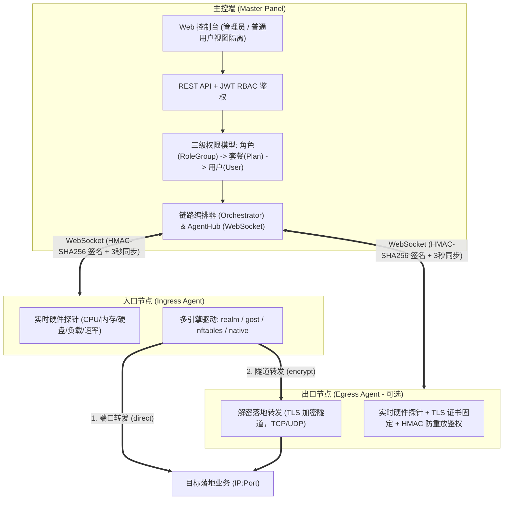
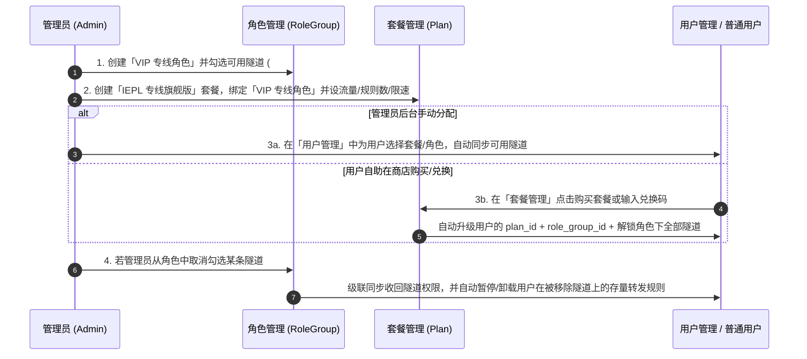

# Zachary Panel 分布式多引擎流量转发面板 —— 部署与使用完整手册

本文档涵盖 **Zachary Panel** 从 **主控端（Master）部署** $\rightarrow$ **节点端（Agent）对接** $\rightarrow$ **创建端口/加密隧道** $\rightarrow$ **角色 / 套餐 / 用户权限配置** $\rightarrow$ **日常转发规则管理与运维排障** 的全流程操作指南。

---

## 一、 架构总览与核心设计



### 1.1 四大转发方式（创建隧道时固化）

| 转发方式 | 核心特点 | 适用场景 |
| :--- | :--- | :--- |
| **`realm`** | Rust 编写，极低内存占用、高并发 TCP/UDP 零配置直转 | 入口单机中转、BGP / IEPL 专线直连转发（**推荐直转首选**；用于加密隧道时自动改用 `native` 加密） |
| **`gost`** | 支持 `TLS` / `WSS` / `WS` / `QUIC` 多协议双端加密隧道 | 跨公网入口 $\rightarrow$ 出口双节点加密隧道转发（**推荐加密隧道首选**） |
| **`nftables`** | Linux 内核态 `DNAT/SNAT` 零拷贝转发，几乎 0 CPU 占用 | 超大带宽（10Gbps+）Linux 专线入口节点纯内核态端口转发（仅直转；加密隧道自动改用 `native`） |
| **`native`** | 纯 Go 内置转发底座，支持令牌桶精准限速；双端隧道统一走 TLS（证书固定）+ HMAC 首包鉴权（含随机数防重放），UDP 封装在加密隧道内 | 无外部二进制依赖的通用转发、精准单规则限速、主备故障自动切换 |

---

## 二、 主控面板（Master）部署指南

### 2.1 环境要求
- **操作系统**：Linux（Ubuntu 20.04+ / Debian 11+ / CentOS 8+）或 Windows Server
- **硬件建议**：1 核 CPU / 1 GB 内存 / 10 GB 磁盘即可流畅支撑百台节点
- **开放端口**：默认 `8080/tcp`（同时承载 Web 面板与 Agent WebSocket 通信 `/api/v1/agent/ws`）

---

### 2.2 方式一：Docker Compose 一键部署（生产推荐）

在服务器任意目录（如 `/opt/zachary-panel`）拉取代码并启动：

```bash
cd /opt/zachary-panel/deploy
docker compose up -d --build
```

默认 [`deploy/docker-compose.yml`](./deploy/docker-compose.yml) 配置如下（**启动前请修改 `NEXUS_PUBLIC_URL`、`NEXUS_ADMIN_EMAIL` 并设置 `NEXUS_ADMIN_PASSWORD`**）：

```yaml
version: "3.9"

services:
  nexus-master:
    build:
      context: ..
      dockerfile: deploy/Dockerfile.master
    container_name: nexus-master
    restart: always
    ports:
      # 建议只监听本机，由 Nginx/Caddy 等反向代理提供 HTTPS 后对外暴露
      - "127.0.0.1:8080:8080"
    environment:
      - NEXUS_LISTEN=:8080
      - NEXUS_DB_DRIVER=sqlite
      - NEXUS_DB_DSN=/data/nexus_panel.db
      # 面板对外访问地址（必须是 https，用于生成 Agent 安装命令与 wss 控制通道）
      - NEXUS_PUBLIC_URL=https://panel.example.com
      # 反向代理地址（逗号分隔 IP/CIDR）。只有来自这些地址的 X-Forwarded-For 才会被信任
      - NEXUS_TRUSTED_PROXIES=172.16.0.0/12
      # 首次启动创建的管理员账号；不设置密码时会随机生成并仅在日志中打印一次
      - NEXUS_ADMIN_EMAIL=admin@example.com
      # - NEXUS_ADMIN_PASSWORD=请替换为至少8位的强密码
      # JWT 签名密钥（≥32 字符）。不设置时自动生成并持久化到 /data/jwt_secret.key
      # - NEXUS_JWT_SECRET=
    volumes:
      # 命名卷（容器以非 root 用户 10001 运行，命名卷会自动设置正确属主）
      - zachary-data:/data

volumes:
  zachary-data:
```

> [!IMPORTANT]
> 端口默认只绑定 `127.0.0.1:8080`，请通过 Nginx/Caddy 提供 HTTPS 后对外暴露（见 2.4 节）。若未设置 `NEXUS_ADMIN_PASSWORD`，首次启动会随机生成管理员密码并**仅在日志中打印一次**：`docker logs nexus-master 2>&1 | grep -i administrator`。主控容器以非 root 用户（UID 10001）运行，数据保存在命名卷 `zachary-data` 中。

> [!TIP]
> **切换 PostgreSQL 或 MySQL 数据库**：
> - **PostgreSQL**：设置 `NEXUS_DB_DRIVER=postgres`，`NEXUS_DB_DSN="host=127.0.0.1 user=nexus password=xxx dbname=nexus port=5432 sslmode=disable"`
> - **MySQL**：设置 `NEXUS_DB_DRIVER=mysql`，`NEXUS_DB_DSN="nexus:password@tcp(127.0.0.1:3306)/nexus?charset=utf8mb4&parseTime=True&loc=Local"`

---

### 2.3 方式二：源码编译与 Systemd 裸机部署

```bash
# 1. 编译前端静态资源 (可选，若使用独立托管)
cd /opt/zachary-panel/web
npm install && npm run build

# 2. 编译主控端与节点端二进制
cd /opt/zachary-panel
CGO_ENABLED=1 go build -o bin/nexus-master ./cmd/master
CGO_ENABLED=0 go build -o bin/nexus-agent ./cmd/agent

# 3. 放置 Agent 二进制，供节点一键安装脚本下载（面板会自动计算 SHA-256 写入安装命令）
mkdir -p deploy/releases
GOOS=linux GOARCH=amd64 CGO_ENABLED=0 go build -o deploy/releases/nexus-agent-linux-amd64 ./cmd/agent
GOOS=linux GOARCH=arm64 CGO_ENABLED=0 go build -o deploy/releases/nexus-agent-linux-arm64 ./cmd/agent

# 4. 启动主控端
export NEXUS_ADMIN_EMAIL="admin@example.com"
export NEXUS_ADMIN_PASSWORD="请替换为至少8位的强密码"
export NEXUS_PUBLIC_URL="https://panel.example.com"
./bin/nexus-master -listen 127.0.0.1:8080 -db-driver sqlite -db-dsn ./data/nexus_panel.db \
  -static-dir ./deploy -web-dir ./web/dist
```

---

### 2.4 配置 Nginx 反向代理（启用 HTTPS 与 WSS）

如果希望通过域名（例如 `panel.example.com`）访问主控并让节点使用 `wss://` 加密连接，请确保配置了 **WebSocket Upgrade 请求头**：

```nginx
server {
    listen 443 ssl http2;
    server_name panel.example.com;

    ssl_certificate     /etc/ssl/certs/panel.crt;
    ssl_certificate_key /etc/ssl/private/panel.key;

    location / {
        proxy_pass http://127.0.0.1:8080;
        proxy_http_version 1.1;
        proxy_set_header Host $host;
        proxy_set_header X-Real-IP $remote_addr;
        proxy_set_header X-Forwarded-For $proxy_add_x_forwarded_for;
        proxy_set_header X-Forwarded-Proto $scheme;

        # 必须开启 WebSocket 支持，供 /api/v1/agent/ws 节点通信使用
        proxy_set_header Upgrade $http_upgrade;
        proxy_set_header Connection "upgrade";
        proxy_read_timeout 3600s;
    }
}
```

---

### 2.5 初始管理员账号与登录

面板首次启动会自动迁移数据库，并创建默认角色、套餐与**一个管理员账号**（不再内置任何固定的演示账号、密码或兑换码）：

- 管理员邮箱取自 `NEXUS_ADMIN_EMAIL`（默认 `admin@nexus.local`），密码取自 `NEXUS_ADMIN_PASSWORD`（8–72 位）。
- 未设置 `NEXUS_ADMIN_PASSWORD` 时会生成随机强密码，并**仅在首次启动日志中打印一次**，请登录后立即通过右上角「修改密码」更换。
- 修改密码、调整角色或封禁用户后，该用户此前签发的所有登录令牌会立即失效。
- 公开注册默认**关闭**，如需开放请在「系统设置」中手动开启。
- 本地体验可设置 `NEXUS_SEED_DEMO=true` 生成演示节点/隧道/普通用户（普通用户密码取自 `NEXUS_DEMO_USER_PASSWORD`，未设置则随机生成并打印），**生产环境请勿开启**。

---

### 2.6 主控端环境变量与安全配置

| 变量 / 参数 | 说明 | 默认值 |
| :--- | :--- | :--- |
| `NEXUS_LISTEN` / `-listen` | HTTP 监听地址 | `:8080` |
| `NEXUS_DB_DRIVER` / `-db-driver` | `sqlite` / `postgres` / `mysql` | `sqlite` |
| `NEXUS_DB_DSN` / `-db-dsn` | 数据库连接串 | `nexus_panel.db` |
| `NEXUS_DATA_DIR` / `-data-dir` | 持久化密钥目录（JWT 密钥文件 `jwt_secret.key`） | SQLite 数据库所在目录 |
| `NEXUS_JWT_SECRET` | JWT 签名密钥（≥32 字符）；不设置时自动生成并持久化，重启后登录不失效 | 自动生成 |
| `NEXUS_PUBLIC_URL` / `-public-url` | 面板对外 HTTPS 地址，用于生成节点安装命令（`wss://` 控制通道） | 按请求 Host 推断 |
| `NEXUS_STATIC_DIR` / `-static-dir` | 存放 `install-agent.sh` 与 `releases/` 二进制的目录 | `./deploy` |
| `NEXUS_WEB_DIR` / `-web-dir` | 前端构建产物目录 | `./web/dist` |
| `NEXUS_TRUSTED_PROXIES` | 受信任的反向代理 IP/CIDR（逗号分隔），仅信任这些来源的 `X-Forwarded-For` | 不信任任何代理 |
| `NEXUS_CORS_ORIGINS` | 允许跨域访问的前端源（逗号分隔）；同域部署无需设置 | 关闭跨域 |
| `NEXUS_ADMIN_EMAIL` / `NEXUS_ADMIN_PASSWORD` | 首次启动创建的管理员账号 | 见 2.5 节 |
| `NEXUS_ALLOW_PRIVATE_TARGETS` | 允许规则目标为内网地址（需同时在节点开启，见 Q2） | `false` |
| `NEXUS_SEED_DEMO` / `NEXUS_DEMO_USER_PASSWORD` | 生成演示数据（仅测试用） | `false` |

> [!WARNING]
> 生产环境务必使用 **HTTPS**：节点控制通道（`wss://`）与安装脚本下载都依赖它防止中间人篡改。面板通过 HTTP 访问时，生成的安装命令会附带 `--allow-insecure-ws` 并在界面中给出风险提示。

---

## 三、 节点端（Agent）对接与运维指南

### 3.1 第一步：在面板中添加节点

使用 **管理员账号** 登录面板，点击左侧菜单 **「基础设施」 $\rightarrow$ 「节点管理」 $\rightarrow$ 「+ 新增节点」**：

| 配置项 | 填写说明 | 示例 |
| :--- | :--- | :--- |
| **名称** | 节点标识名称，便于区分地域或线路类型 | `深圳前海 BGP 入口 #1` |
| **连接地址 (`connect_ip`)** | **面向最终客户端连接使用的公网 IP 或 CNAME 域名**。用户在「转发管理」列表点击复制的连接地址即取自此字段 | `120.24.100.10` 或 `sz-bgp.example.com` |
| **节点 IP (`server_ip`)** | **节点服务器真实公网/专线内网通信 IP**。当该节点作为加密隧道的「出口节点」时，入口节点将向此 IP 发起隧道对接；留空默认同连接地址 | `10.10.10.2` 或 `203.0.113.20` |
| **端口范围 (`port_range`)** | 允许用户在该节点上分配监听端口的范围（面板会自动规避冲突端口与系统高危端口）。隧道可在此范围内再单独划分端口段（见 4.1）；缩小节点范围时，若会把某条隧道的端口范围排除在外，保存会被拒绝 | `10000-50000` |
| **流量倍率 (`traffic_rate`)** | 节点级基准倍率（默认为 `1.0`） | `1.0` |
| **流量限额 (GB)** | 该节点服务器月度总流量上限（填 `0` 表示不限制）。**当节点已用流量达到限额时，面板会自动熔断暂停该节点上的转发规则** | `2000` |
| **已用流量 (GB)** | 可手动校准当前节点的已消耗流量 | `0` |

---

### 3.2 第二步：获取对接命令并部署 Agent

节点创建后，在「节点管理」列表中点击该节点右侧的 **「对接」** 按钮，面板会自动生成带专属 `Node ID`、`HMAC Secret Token`（32 字节随机）与 Agent 二进制 `SHA-256` 校验值的一键安装与卸载命令（**请直接复制面板生成的命令**，以下仅为格式示例）。支持 **Systemd 服务（推荐）** 和 **Docker 容器** 两种部署方式：

#### 方式 A：Systemd 系统服务部署（推荐，支持 `nftables` 内核转发与进程级端口统计）

- **一键安装命令**（在目标节点服务器上以 `root` 执行）：
  ```bash
  curl -fsSL 'https://panel.example.com/deploy/install-agent.sh' | sudo bash -s -- \
    --panel 'https://panel.example.com' \
    --master 'wss://panel.example.com/api/v1/agent/ws' \
    --id 1 \
    --token '<面板生成的节点专属Token>' \
    --sha256-amd64 <面板计算的校验值> --sha256-arm64 <面板计算的校验值>
  ```
  > 安装脚本会校验下载的 Agent 二进制 SHA-256，校验失败即中止；配置写入 `/etc/nexus-agent/agent.env`（权限 `0600`），运行状态保存在 `/var/lib/nexus-agent`（权限 `0700`）。
- **一键卸载命令**（自动停止服务、清理 `/etc/nexus-agent`、`/var/lib/nexus-agent` 与 `nftables` 内核规则表）：
  ```bash
  curl -fsSL 'https://panel.example.com/deploy/install-agent.sh' | sudo bash -s -- --uninstall
  ```
- **常用服务管理命令**：
  ```bash
  # 查看 Agent 运行状态与实时日志
  systemctl status nexus-agent
  journalctl -u nexus-agent -f

  # 手动重启 Agent 服务（重启后毫秒级自动恢复全部转发规则）
  systemctl restart nexus-agent
  ```

#### 方式 B：Docker Host 网络容器部署

- **先在节点上构建本地镜像**（项目不依赖任何第三方镜像仓库，避免镜像被冒名替换）：
  ```bash
  git clone https://github.com/huge1225/zachary-panel.git && cd zachary-panel
  docker build -f deploy/Dockerfile.agent -t zachary-panel-agent:latest .
  ```
- **一键安装命令**（必须使用 `--net=host` 与 `--cap-add=NET_ADMIN`）：
  ```bash
  docker run -d --name nexus-agent-1 --restart always \
    --net=host --cap-add=NET_ADMIN \
    -v nexus-agent-1:/var/lib/nexus-agent -e NEXUS_STATE_DIR=/var/lib/nexus-agent \
    -e NEXUS_MASTER_URL='wss://panel.example.com/api/v1/agent/ws' \
    -e NEXUS_NODE_ID=1 \
    -e NEXUS_NODE_TOKEN="<面板生成的节点专属Token>" \
    zachary-panel-agent:latest
  ```
- **一键卸载命令**：
  ```bash
  docker stop nexus-agent-1 && docker rm -v nexus-agent-1
  ```

#### Agent 启动参数

| 参数 / 环境变量 | 说明 |
| :--- | :--- |
| `-master` / `NEXUS_MASTER_URL` | **必填**，主控 WebSocket 地址，生产环境必须为 `wss://` |
| `-id` / `NEXUS_NODE_ID` | **必填**，节点 ID |
| `-token` / `NEXUS_NODE_TOKEN` | **必填**，节点密钥（至少 16 位） |
| `-state-dir` / `NEXUS_STATE_DIR` | 私有状态目录（规则快照、隧道 TLS 证书、引擎配置），默认 `/var/lib/nexus-agent` |
| `-allow-insecure-ws` / `NEXUS_ALLOW_INSECURE_WS` | 允许连接非本机的 `ws://` 主控（明文，不推荐） |
| `-allow-private-targets` / `NEXUS_ALLOW_PRIVATE_TARGETS` | 允许转发到内网地址（默认禁止，防 SSRF） |
| `-master-pin-sha256` / `NEXUS_MASTER_PIN_SHA256` | 可选，固定主控 TLS 证书指纹 |
| `-min-port` / `-max-conns-per-ip` / `-report-interval` | 最小监听端口（默认 1024）/ 单 IP 并发上限 / 上报间隔 |
| `-nft-selfcheck` | 用 `nft -c` 空跑校验面板生成的 nftables 规则后退出，不修改系统（需 root） |

> [!NOTE]
> 引擎能力差异：规则限速与单 IP 并发上限在 `native` 引擎下完整生效；`nftables` 支持按规则限速（内核 `limit`），不支持单 IP 并发上限；`gost` / `realm` 为外部进程，无法执行限速与单 IP 并发上限，因此**普通用户的规则只要带有限速，就会自动改用 `native` 引擎下发**（管理员自己的规则保持所选引擎），套餐带宽无法通过选择引擎绕过。

> **nftables 上线前自检**：在使用 `nftables` 引擎的节点上（首次部署、升级内核或 nft 版本后）执行一次 `sudo nexus-agent -nft-selfcheck`。它会用 `nft -c` 空跑校验面板生成的转发 / 计数 / 限速规则，不会修改任何系统规则；输出 `self-check OK` 即可放心使用，失败时会打印 nft 的报错与完整规则脚本。

---

### 3.3 节点同步频率与服务重启自愈机制

1. **三层同步策略**：
   - **探针与流量同步（`3 秒/次`）**：Agent 每 3 秒采集一次节点 CPU、负载 (`Load 1/5/15`)、内存容量、硬盘容量、实时上下行网卡速率、活跃连接数及每条规则的精确进出流量增量上报主控；管理员「概览」页每 3 秒静默刷新展示。
   - **规则变更推送（`0 延迟实时下发`）**：新增、编辑、暂停、删除规则或调整角色权限时，主控通过 WebSocket 实时推送经 `HMAC-SHA256` 签名的指令帧到对应节点。
   - **全量状态对账（`60 秒/次`）**：主控后台每 60 秒执行一次配额巡检与在线节点全量规则哈希对账（`ReconcileAllOnlineNodes`）。
2. **服务重启规则自愈（双重保障）**：
   - **本地持久化快照秒级恢复**：Agent 每次接收规则变更都会原子写入本地快照（`<state-dir>/rules-snapshot.json`，默认 `/var/lib/nexus-agent/rules-snapshot.json`，权限 `0600`）。当服务器重启或 `nexus-agent` 进程重启时，Agent 启动第一件事即调用 `RestoreSnapshot` 立即拉起所有转发规则，**即使此时主控端短暂离线也不影响转发业务恢复**。
   - **主控重连全量重同步 + 手动一键同步**：Agent 重连上主控 WebSocket 的瞬间，主控会自动下发最新全量启用规则；管理员也可随时在「节点管理」点击 **「同步」** 按钮强制重启并同步该节点的所有规则。

---

## 四、 创建隧道指南（端口转发 vs 隧道转发）

> [!IMPORTANT]
> **核心原则**：在 Zachary Panel 中，**转发方式（`realm` / `gost` / `nftables` / `native`）与出入节点拓扑在「创建隧道」时即已固化**。用户在创建转发规则时只需选择已授权的隧道，无需也无权篡改底层转发方式。

点击左侧菜单 **「基础设施」 $\rightarrow$ 「隧道管理」 $\rightarrow$ 「+ 新增隧道」**：

### 4.1 模式一：端口转发 (`direct` · 单节点直转)
适用于单台入口服务器直接将流量转发至目标地址（或通过内网专线直连目标）：
1. 选择顶部模式卡片：**「端口转发」**。
2. **名称**：例如 `深港专线直转`。
3. **转发方式**：推荐选择 `realm`（极速轻量）或 `nftables`（Linux 内核态零拷贝）。
4. **入口节点**：选择已在线的入口节点（如 `深圳入口 #1`）。
5. **计费方式 / 流量倍率 / 端口配额**：
   - **单向计费 (`one_way`)**：取 $\max(\text{上行流量}, \text{下行流量}) \times \text{流量倍率}$ 计入用户已用流量。
   - **双向计费 (`two_way`)**：取 $(\text{上行流量} + \text{下行流量}) \times \text{流量倍率}$ 计入用户已用流量。
   - **端口配额 (`max_port_count`)**：限制该隧道下最多允许创建的转发规则数量（如 `100`）。
   - **端口范围 (`port_range`，选填)**：为该隧道单独规划入口节点上的监听端口段（如 `20000-20999`），该隧道下的规则只在此范围内分配端口，便于按隧道/客户划分端口与配置防火墙。必须位于入口节点端口范围之内；留空则使用节点端口范围。修改后对新分配的端口生效。

### 4.2 模式二：隧道转发 (`encrypt` · 入口-出口双端加密专线)
适用于「国内公网入口节点 $\rightarrow$ 海外/香港出口节点」需要加密隐藏流量特征的场景：
1. 选择顶部模式卡片：**「隧道转发」**。
2. **名称**：例如 `广港加密隧道`。
3. **转发方式**：推荐选择 `gost` 或 `native`。
4. **入口节点**：选择国内入口节点（如 `广州入口 #1`）。
5. **出口节点**：选择境外/落地出口节点（如 `香港出口 #2`）。
6. **端口范围（选填）**：与端口转发相同，可为该隧道在入口节点上单独规划监听端口段（出口节点的中继端口仍按出口节点端口范围分配）。
7. **传输协议**：支持选择 `TLS`、`WSS`、`WS`、`QUIC`（`native` 引擎下统一使用经证书校验的 TLS 加密；`realm` / `nftables` 不具备隧道加密能力，加密隧道会自动改用 `native`）。
   - **自动化双端编排说明**：当用户在该加密隧道下创建一条转发规则时，主控 `Orchestrator` 会自动完成两步下发：
     1. 在 **出口节点** 自动分配中继监听端口并生成 `32 字节随机隧道密钥`；出口节点使用自身持久化的 TLS 证书提供服务，并对首包做 HMAC 鉴权（含时间戳与随机数防重放），未授权连接将被静默丢弃；
     2. 在 **入口节点** 自动配置加密客户端对接出口节点的 `server_ip:中继端口`，并**固定校验出口节点上报的证书**（出口节点尚未上线上报证书前，入口侧会拒绝建立隧道），实现零手工干预的双端加密链路闭合。

---

## 五、 角色 / 套餐 / 用户权限配置全流程

Zachary Panel 采用 **「角色决定可用隧道 $\rightarrow$ 套餐绑定角色 $\rightarrow$ 用户分配套餐与角色」** 三级权限架构，彻底杜绝普通用户越权使用未授权的高级专线。



### 5.1 第一步：配置「角色管理」（决定可用哪些隧道）
1. 进入左侧菜单 **「权限与系统」 $\rightarrow$ 「角色管理」**。
2. 点击 **「+ 新增角色」** 或点击现有角色的 **「编辑 / 配置隧道」**：
   - **角色名称**：例如 `标准角色`、`VIP 专线角色`、`企业定制角色`。
   - **角色说明**：备注该角色适用的线路等级。
   - **可用隧道**：勾选允许该角色使用的隧道（例如 `标准角色` 仅勾选 `#1 深港专线直转`；`VIP 专线角色` 勾选 `#1 深港专线直转` + `#2 广港加密隧道`）。
3. **级联生效规则**：保存角色后，所有绑定该角色的 **套餐 (`Plan`)** 与 **普通用户 (`User`)** 的可用隧道会**立即同步更新**。如果某条隧道权限被移除，该角色下所有用户在被移除隧道上的存量规则会**立即自动暂停并从 Agent 节点卸载**，且禁止用户再次开启。

---

### 5.2 第二步：配置「套餐管理」（套餐绑定角色）
1. 进入左侧菜单 **「业务中心」 $\rightarrow$ 「套餐管理」**（管理员视角顶部会显示套餐管理总表与 **「+ 新增套餐」** 按钮）。
2. 点击 **「+ 新增套餐」** 或 **「编辑」**：
   - **套餐名称**：如 `IEPL 专线旗舰版`。
   - **绑定角色 (`role_group_id`)**：下拉选择刚才创建的 `VIP 专线角色`（弹窗内会实时预览该角色包含的可用隧道标签）。
   - **价格 (元) & 周期 (天)**：如 `89.00` 元 / `30` 天。
   - **流量配额 (GB) / 最大规则数 / 限速 (Mbps)**：如 `1024 GB`、`50 条规则`、`500 Mbps`。
3. **用户购买与兑换自动升级**：
   - 当普通用户在「套餐管理」中点击 **「立即订阅并激活角色」** 或使用绑定了该套餐的兑换码核销后，系统会通过数据库事务原子扣费，并自动将用户的 `plan_id`、`role_group_id`、`allowed_tunnels`、流量配额、最大规则数和限速同步升级为该套餐的配置。

---

### 5.3 第三步：配置「用户管理」（为用户分配套餐与角色）
1. 进入左侧菜单 **「权限与系统」 $\rightarrow$ 「用户管理」**。
2. 点击 **「+ 新增用户」** 或某位用户右侧的 **「分配套餐/角色」**：
   - **分配套餐 (`plan_id`)**：下拉选择套餐（如切换为 `IEPL 专线旗舰版`）时，表单会**自动联动带出**该套餐绑定的 **所属角色 (`VIP 专线角色`)** 以及对应的流量配额、规则数量和限速。
   - **分配角色 (`role_group_id`)**：管理员也可以在不改变用户套餐配额的前提下，单独调整用户的「分配角色」以临时调整其可用隧道范围。
   - **流量与状态维护**：支持手动调整用户的总流量配额 (`quota_gb`) 与已用流量 (`used_gb`)、点击 **「重置流量」** 一键清零已用流量并自动恢复因超额暂停的规则、点击 **「封禁 / 解封」** 实时切断或恢复该用户的全部转发服务。

---

### 5.4 第四步：配置「系统设置」（全局品牌与新用户默认角色）
进入左侧菜单 **「权限与系统」 $\rightarrow$ 「系统设置」**：
- **面板名称 & Logo 标识**：自定义左上角与登录页展示的品牌名称（如 `Zachary Panel`）及 2~4 字符渐变徽标（如 `ZP`）。
- **系统公告**：填写后会醒目展示在所有用户的「概览」页顶部；留空则自动隐藏。
- **开放注册 & 新注册用户默认角色**：控制是否允许外部用户自助注册，并指定新注册用户默认分配的角色（如 `标准角色`）及初始赠送流量/规则数/限速。

---

## 六、 用户端转发规则使用指南

普通用户登录后，左侧菜单仅展示 **「概览」**、**「转发管理」**、**「套餐管理」** 三个模块（无权查看节点服务器硬件探针、节点内部 `server_ip` 及任何管理员菜单）。

### 6.1 新增与编辑单条转发规则
1. 进入 **「转发管理」**，点击右上角 **「+ 新增转发」**（或在「概览」页已授权隧道列表右侧点击 **「添加转发」**）：
   - **隧道**：下拉框仅展示当前用户所属角色已授权的隧道（后端接口同样执行强制 `HasTunnelPermission` 校验，严防抓包篡改 `tunnel_line_id` 越权）。
   - **名称**：填写业务备注名称（如 `港服游戏加速`）。
   - **协议**：支持 `TCP`、`UDP`、`TCP+UDP (both)`。
   - **监听端口**：可指定隧道端口范围（未设置时为节点端口范围，如 `10000-50000`）内的端口号，或填 `0` / 留空由系统自动分配空闲端口。同一节点上的监听端口另有数据库唯一索引兜底（SQLite / PostgreSQL / MySQL 8.0.13+；旧版 MySQL 或历史数据已有重复端口时仅在启动日志告警）。面板按单主控实例设计，多主控并发创建时极少数请求可能因冲突返回错误，重试即可；出口节点中继端口不在该索引覆盖范围内。
   - **负载均衡**：当填写多个目标地址时，支持 **「轮询 (`round_robin`)」** 或 **「主备 (`failover`)」** 自动故障切换。
   - **目标地址**：每行填写一个落地 `IP:端口` 或 `域名:端口`（默认开启防 SSRF 保护，禁止转发至 `127.0.0.1`、`10.0.0.0/8`、`169.254.169.254` 等内网与云元数据地址）。
2. 创建完成后，点击列表「连接地址」列的蓝色胶囊按钮（如 `120.24.100.10:10001`）即可一键复制连接地址。

### 6.2 批量导入与一键导出规则
- **批量导入**：点击「转发管理」右上角 **「批量导入」**，选择目标隧道与协议，按每行一条输入即可一次创建多条规则：
  ```text
  业务节点A|10021|1.1.1.1:443
  业务节点B|0|8.8.8.8:53
  ```
  > 注：第二列监听端口填 `0` 代表由系统自动分配可用端口。
- **导出规则**：点击 **「导出规则」**，即可将当前列表中的所有规则按 `名称|监听端口|目标地址` 标准格式一键复制到剪贴板，方便备份或迁移。

### 6.3 端到端分段测速
在「转发管理」列表中点击某条规则右侧的 **「测速」** 按钮：
- **端口转发 (`direct`)**：由入口节点直接对目标地址发起真实 TCP 握手探测，返回延迟（如 `12ms`）。
- **隧道转发 (`encrypt`)**：由入口节点与出口节点协同探测，同时返回 **「隧道延迟 + 落地延迟」**（例如 `隧道 8ms + 落地 5ms`），方便快速定位是跨网专线抖动还是落地目标服务器故障。

---

## 七、 常见运维排障 (FAQ)

### Q1：节点执行安装命令后，面板上状态仍显示「离线」？
1. 检查主控端防火墙/安全组是否放行了 HTTPS（`443/tcp`，或您直接暴露的面板端口）。
2. 若主控配置了 Nginx 反代，请确认已配置 `proxy_set_header Upgrade $http_upgrade;` 与 `Connection "upgrade";`（详见 [2.4 节](#24-配置-nginx-反向代理启用-https-与-wss)）。
3. 检查节点与主控的系统时间误差是否在 **$\pm 60$ 秒以内**（Agent 与 Master 采用 `HMAC-SHA256` + 时间戳防重放校验，建议在服务器开启 `chrony` 或 `systemd-timesyncd` 自动同步 NTP 时间）。

### Q2：用户在「转发管理」保存规则时提示「目标地址被安全策略拦截 (SSRF)」？
- 为防止恶意用户利用转发节点扫描内网或读取云厂商元数据（`169.254.169.254`），Agent 默认开启了严格的 `SafeDialTCP` 内网段拦截。
- 若您处于纯内网专线环境、确实需要转发至 `10.x.x.x` / `192.168.x.x` 等私有地址，需**同时**：
  1. 在主控端设置环境变量 `NEXUS_ALLOW_PRIVATE_TARGETS=true` 并重启面板；
  2. 在节点 `/etc/nexus-agent/agent.env` 中设置 `NEXUS_ALLOW_PRIVATE_TARGETS=true` 后执行 `systemctl restart nexus-agent`。
- 无论是否开启，域名目标都会先解析并固定为通过安全校验的 IP，防止 DNS 重绑定绕过。

### Q3：修改了某个角色的可用隧道后，需要手动去暂停用户的旧规则吗？
- **不需要**。当管理员在「角色管理」中取消勾选某条隧道并保存时，系统会自动遍历所有绑定该角色的套餐与用户，收回对应隧道权限，并将这些用户在被移除隧道上的存量运行中规则**自动切换为暂停状态、同步从 Agent 节点卸载**。

### Q4：创建转发时提示「端口 xxx 不在允许范围内」或「no free ports available」？
- 监听端口只能在**隧道端口范围**内分配（隧道未设置时使用入口节点的端口范围）。请改填范围内的端口或留空自动分配。
- 若范围内端口已全部占用，请在「隧道管理」中扩大该隧道的端口范围（需仍在入口节点范围内），或在「节点管理」中扩大节点端口范围。
- 修改隧道端口范围只影响之后新分配的端口；已有规则保持原端口，编辑并切换隧道时会自动重新分配到新范围内。

### Q5：选了 `gost` / `realm` 的隧道，为什么规则实际以 `native` 运行？
- `gost` / `realm` 是外部进程，无法执行面板的单规则限速。为保证套餐带宽不被绕过，**普通用户带限速的规则会自动改用 `native` 引擎**下发；加密隧道在 `realm` / `nftables` 下也会改用 `native` 以保证链路加密。管理员自己的规则保持所选引擎。

### Q6：如何确认节点的 nftables 引擎可用？
- 在节点上执行 `sudo nexus-agent -nft-selfcheck`：输出 `self-check OK` 表示当前内核与 nft 版本接受面板生成的转发、计数与限速规则；失败时会打印 nft 报错及完整规则脚本，便于排查（常见原因：未安装 `nftables` 包、内核版本低于 5.2 不支持 inet 表 DNAT、未以 root 运行）。
